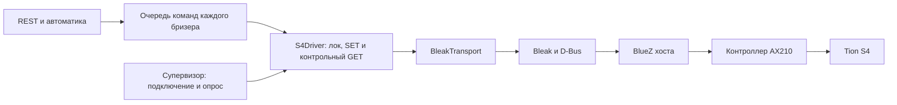

# Bluetooth в Easy Breezy: результаты исследования

**8 октября 2026 года**, версия 0.3.0, коммит `bc04c3c`.
Последующая реализация и проверка 0.3.2: [результат доработок](4_delivery.md).

Проверены исходники, реально установленные библиотеки, настройки NUC,
недельная история измерений и команд, системные журналы и трёхминутная
пассивная HCI-трасса. Пять дефектов воспроизведены локально на моделях.
Рабочий код, конфигурация, бонды и состояние радио не изменялись;
перезапуски и активные подключения в рамках исследования не выполнялись.

## Главный вывод

**В нашем коде есть конкретные проблемы жизненного цикла соединения и
подтверждения команд. Объяснять все отключения только слабым радио или
MagicAir нельзя.** При этом установить единственную причину сегодняшнего
эпизода детской не удалось: подробные логи предыдущего контейнера удалены
при штатной выкладке, а HCI-захвата момента отказа нет.

Первым стоит исправить освобождение частично открытого соединения,
корреляцию ответов и сохранение диагностических данных. Полная переделка
Bluetooth-слоя или смена библиотек по имеющимся данным не требуется.

## Подтверждённые проблемы

«Подтверждён» ниже означает доказательство кодом и локальным
воспроизводителем; это не утверждение, что именно данный дефект сработал
в утреннем эпизоде. Воспроизводители и подробные условия —
[разбор кода](2_code_trace.md).

| Приоритет | Проблема | Что может происходить | Основание |
|---|---|---|---|
| Высокий, доступность | **C1: нет cleanup после частично успешного подключения** | Connect завершился, подписка на уведомления упала; соединение остаётся, а следующая попытка ищет рекламу уже подключённого бризера. Получается длительное «не найден в эфире». | `ble/supervisor.py:138–152`, `ble/transport.py:117–140`; mock: `disconnect_calls=0`, соединение осталось открыто. |
| Высокий, достоверность | **C2: ответ не сопоставляется с запросом** | Поздний ответ прошлого GET завершает новый GET; сервер считает старое состояние новым подтверждением. | `ble/driver.py:293–296`; mock вернул старую скорость 2 при текущей 5. В живой трассе GET echo `request_id` подтверждён 17/17 пар на всех трёх S4. |
| Средний, таймауты и повторы | **C5: 4 секунды не покрывают предусмотренный fallback** | SET применился, его подтверждение потеряно; после ожидания 3 секунд времени на контрольный GET не хватает. Команда объявляется просроченной и обычный SET может повториться. | `core/bus.py:164,449–482,518–524`; воспроизведено с GET 1.18 с: физическое состояние изменилось, результат — TimeoutError на 4.0 с. |
| Средний, целостность настроек | **C3: дельта вычисляется до захвата лока драйвера** | Пока команда ждёт параллельный опрос, он читает новое состояние. Затем полный SET возвращает неуказанные поля к более старым значениям. | `core/bus.py:518–524`, `ble/driver.py:128`; mock: команда только скорости вернула звук с False на старое True. |
| Низкий, завершение операций | **C4: незавершённый waiter после ошибки записи SET** | После исключения остаётся future, которую уже никто не ждёт; возможны позднее завершение и непотреблённая ошибка. | `ble/driver.py:129–144`; mock подтвердил сохранённый pending waiter. Сам по себе бесконечный offline этим не доказан. |
| Высокий, диагностика | **E1: штатный рестарт уничтожает историю приложения** | После восстановления уже нельзя увидеть причину частичного подключения и последовательность попыток. | `deploy/systemd/easy-breezy.service:17` делает compose down; Docker json-file привязан к удаляемому контейнеру; `log_dir=None`. Это наблюдалось при текущем сборе данных. |

Для C1 важно различие: Bleak 3.0.2 сам выполняет cleanup при ошибках
**внутри connect**. Наш пробел начинается после его успешного возврата,
например на `start_notify`. Не каждый timeout подключения означает утечку.

Для C2 нельзя просто отбрасывать все незнакомые STATE: асинхронные
обновления по-прежнему нужны кэшу и интерфейсу. Ответ текущей операции
должен завершать соответствующий waiter; остальные кадры надо обрабатывать
отдельно. Эхо для SET ещё не проверено живым захватом.

Для C3 не требуется конкурирующее приложение: новое состояние может
появиться после нажатия на самом бризере или корректировки прошивкой.

Сверка с `c8cc31b` подтвердила, что C1, C2 и бюджет 4 секунды уже были
в коде до 0.3.0. Это не новые ветки, добавленные вместе с Qingping;
частота их проявления на рабочем оборудовании пока не установлена.

## Что показала рабочая система

1. **Длинные паузы телеметрии были и до Qingping.** 5 октября
   детская, спальня и гостиная по очереди имели промежутки без состояний
   20:20, 16:31 и 22:03. В каждом случае остальные два отвечали каждые
   30–31 секунду. Это не общий простой сервиса. Причина и действия
   владельца с питанием в тот день неизвестны; плановое выключение
   устройств не исключено, поэтому называть эти паузы дефектами нельзя.
2. **8 октября детская перестала отдавать состояния около выкладки.**
   Последнее — 08:01:18 UTC, следующее — 08:13:05: промежуток 707 секунд.
   Первое восстановление было до второго рестарта приложения в 08:14:21.
   Точного времени перезапуска питания владельцем нет, поэтому причинную
   связь с конкретным действием установить нельзя.
3. **Успешные команды не означают непрерывную связь.** За доступную неделю
   218 обычных команд завершились `done`, ни одной `failed/timeout`.
   Команд во время провалов могло не быть. Три проверочных сброса фильтров
   исключены: аппаратный результат подтверждён, их статус описан в
   [отчёте выкладки](../../filters-qingping/reports/6_implementation.md).
4. **После восстановления короткое наблюдение штатное.** Пассивный
   `btmon` 08:28:23–08:31:23: 17 GET и 17 полных ответов, все CRC верны,
   HCI-разрывов нет. Медиана ответа гостиной — 1.18 с, детской — 0.12 с,
   спальни — 0.10 с. Ранее у гостиной был один `poll_missed` без reconnect.

Промежуток между точками телеметрии не равен точной длительности offline.
Пассивная трасса после восстановления не объясняет предшествующий отказ.
Все времена здесь UTC; для Москвы прибавить три часа.
Полная хронология и методика подсчёта — [1_timeline.md](1_timeline.md).

## Окружение ПК: что настроено и что ещё проверять

На NUC один Intel AX210, Ubuntu 26.04, kernel 7.0.0-29, BlueZ 5.85.
В контейнере Bleak 3.0.2 и dbus-fast 5.0.22 — те же версии были до 0.3.0.
Приложение работает через D-Bus хостового BlueZ, бонды хранятся на хосте.

| Направление | Установлено | Вывод |
|---|---|---|
| LE supervision timeout | В main.conf 500; `btmgmt read-sysconfig` также вернул 500, то есть default 5 с | Старая настройка 420 мс сейчас не подтверждается. Negotiated timeout отдельных линков этим не измерен. |
| Радиосигнал | Гостиная −86…−88, детская −84…−86, спальня −80…−82 dBm | Радио остаётся возможным фактором, но не универсальным объяснением всех наблюдений. |
| Wi-Fi и scan | Wi-Fi soft blocked, Bluetooth powered; `Discovering=no` | Локальный Wi-Fi не работает; непрерывный активный scan при проверке не наблюдался. |
| USB autosuspend | Разрешён, задержка 2 с; контроллер active, накопленные suspend-счётчики малы | Это направление для проверки корреляции, не найденная причина. Отключение питания/энергосбережения сейчас не обосновано как первое исправление. |
| Другие Bluetooth-клиенты | Есть аудиосервисы; свидетельств конкурирующего scan/connect нет | Наличие процесса не означает конфликт радио. Бризеры давно отвязаны от MagicAir, со слов владельца. |
| Qingping | В реестре нет, фоновый сканер не запущен | Текущий длительный offline нельзя приписать непрерывному Qingping-сканированию. |
| Остановка контейнера | Grace по умолчанию 10 с, один disconnect тоже допускает 10 с, до него останавливаются другие сервисы | Возможен обрыв cleanup при остановке. Фактический SIGKILL в утреннем эпизоде не подтверждён. |

В runbook есть чрезмерно категоричные советы: `btmgmt power` назван более
полным reset, хотя в BlueZ 5.85 он, как и `Powered`, доходит до
`MGMT_OP_SET_POWERED`; успешное подключение к другому устройству объявлено
доказательством исправности адаптера; `Trusted=yes, Paired=no` —
доказательством испорченного кэша. Эти выводы следует смягчить до проверяемых
гипотез, особенно перед удалением бондов.
Подробности, команды чтения и первичные источники —
[3_environment.md](3_environment.md).

## Как устроены API, ретраи и восстановление

Реализация уже использует `BLEDevice` после явного поиска, общий gate для
установления соединений и поиска, отдельную очередь каждого бризера,
driver-lock и чтение после SET. Эти решения стоит сохранить.

Ретраи существуют на нескольких независимых уровнях:

- поиск — 14 с с внешним пределом 15 с; connect — 10 с в Bleak и внешний
  предел 20 с; start_notify/disconnect — до 10 с;
- опрос — примерно раз в 30 с; три неудачных ожидания ответа по 3 с ведут
  к пересозданию сессии. Явный разрыв обнаруживается раньше;
- reconnect — 1, 2, 4, 8, 16, 20 с плюс до 25% jitter. После успешного
  периодического опроса пауза сбрасывается. Старая проблема бесконечно
  накопленного backoff в текущем коде исправлена;
- обычная команда — две попытки по 4 с; ручная ждёт offline-устройство
  до 30 с, автоматическая до 180 с. Если драйвер всё ещё ONLINE,
  повтор может снова попасть в ту же сессию;
- сброс фильтров — отдельная операция, до 15 с, без автоматического
  повторного SET;
- BLE-watchdog — сброс адаптера после 10 минут **всех** offline,
  затем завершение приложения ещё через 10 минут;
- watchdog хоста следит за HTTP. Ответ `/health=ok` подтверждает живость
  HTTP-процесса, а не свежесть обмена с каждым бризером.

Следствия:

1. **Один залипший бризер общий watchdog не восстановит.** Это текущая
   политика, а не поломка самого таймера. Общий reset из-за одной комнаты
   затронет исправные устройства; сначала нужен cleanup C1 и диагностика
   расхождения нашего состояния с BlueZ Device1.
2. **Gate действует внутри процесса.** CLI `breezy scan/monitor/state`,
   настройки Bluetooth на рабочем столе и другой контейнер его обходят.
   В исследовании использовался пассивный btmon, а не дополнительный scan.
3. **Не все D-Bus операции ограничены временем.** Вспомогательные вызовы
   pairing и watchdog-reset, start/stop обычного discovery не имеют
   общего прикладного бюджета. Зависшее ожидание может задержать gate
   или прекратить дальнейшие тики BLE-watchdog, пока HTTP остаётся жив.
   Факт такого зависания в текущем эпизоде не установлен.
4. **CRC сейчас проверяется мягко.** Кадр с ошибочной CRC логируется, но
   всё же может обновить состояние. В наблюдении все 34 кадра корректны;
   это основание подготовить проверку строгого режима на наших прошивках,
   но не доказательство частых повреждений.

## Предлагаемый порядок исправлений

| Шаг | Узкая работа | Критерий проверки |
|---|---|---|
| 1. Сохранить доказательства | Включить существующий файловый logging на постоянном томе; добавить адрес, стадию, длительность и номер попытки на INFO | После пересоздания контейнера предыдущая сессия и исходная ошибка доступны; payload/секреты не пишутся. |
| 2. Закрыть lifecycle | C1 и C4; cleanup на error/cancel каждого этапа, ограниченные D-Bus/scan/stop фазы | Connect success → notify failure/cancel не оставляет соединения и удержанного gate; последующая попытка восстанавливается. |
| 3. Надёжно подтверждать команды | C2: корреляция GET с сохранением асинхронных state updates; отдельно проверить SET | Поздние ответы не подтверждают новый запрос; GET echo на трёх устройствах уже проверен. |
| 4. Согласовать управление | C5: бюджет включает разрешённые ожидания и контрольное чтение; C3: выбор базы и merge под одним локом | Потерянный SET-ответ не превращает допустимо медленный readback в преждевременный timeout; меняется только запрошенное поле. |
| 5. Проверить восстановление в эксплуатации | Ограниченная проверка остановки/старта сервиса, одного исчезнувшего бризера, BlueZ/адаптера; записывать HCI до восстановления | Shutdown успевает завершить cleanup; после возвращения связи все устройства восстанавливаются; известна причина каждого принудительного завершения. |

Targeted recovery конкретного MAC добавлять, если после исправлений
остаётся воспроизводимое расхождение: приложение offline, а BlueZ держит
наше старое соединение. Общие power-cycle, удаление сопряжений, обновление
всего стека и переработку адаптеров не делать первым шагом.

Проверку антенны/размещения, USB autosuspend и firmware выполнять как
отдельные сравнения при неизменном коде и измеримых симптомах. С реальным
Qingping дополнительно проверить совместный приём и доставку команд Tion;
датчик пока не получен, этот пункт остаётся открытым.

## Проверки и ограничения результата

- Пять локальных воспроизводителей C1–C5 без BLE и без изменений исходников;
  их код сохранён в приложении [2_code_trace.md](2_code_trace.md).
- 18 существующих driver/supervisor/coordinator-тестов прошли. Они не
  моделируют частично успешный Bleak start и реальное сочетание таймаутов
  3/4 секунды; зелёные тесты не опровергают найденные сценарии.
- Недельный срез БД прочитан в режиме read-only; системные данные и
  HCI-трасса получены без изменения рабочего состояния.
- Натурные отказы notify/cancel, отключение USB, рестарт BlueZ и длительное
  наблюдение после исправлений не выполнялись. Реальных исправлений в этом
  исследовании нет.

Материалы: [хронология](1_timeline.md), [код и воспроизводители](2_code_trace.md),
[окружение и источники](3_environment.md).
